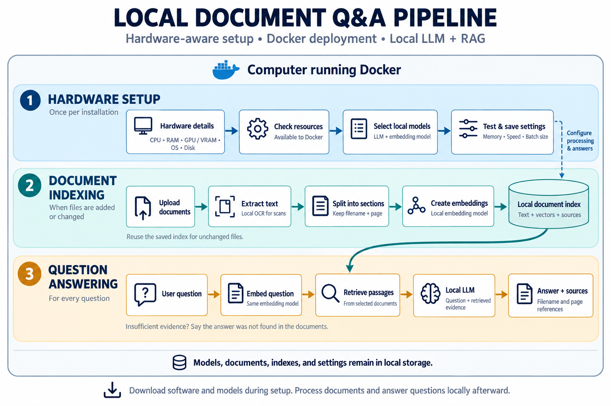

# Local Docs QA

A document question-answering app being built around local large language models (LLMs), retrieval-augmented generation (RAG), and hardware-aware configuration.

The goal is to let users run the app with Docker, upload documents, and ask questions using models suited to their computer. Document processing, embeddings, retrieval, and answer generation are intended to run locally.

> **Status: early development.** The current implementation collects hardware information. The web interface, automatic model selection, document processing, RAG, and Docker deployment are planned features.

## Current functionality

The `HardwareDetails` class automatically collects information when an object is created:

- CPU model, architecture, and logical CPU count.
- Total and available system RAM.
- NVIDIA GPU name and total, used, and free GPU memory through NVML.

Memory values are stored in **GiB** (`bytes / 1024**3`).

## Planned pipeline



The diagram shows the intended application workflow:

1. **Inspect hardware:** collect CPU, RAM, GPU, operating system, and storage information; check resources available to Docker.
2. **Configure models:** choose candidate local LLMs and embedding models, test their memory use and speed, and save suitable settings.
3. **Upload documents:** validate supported files, save originals, and identify duplicates or changed content.
4. **Process content:** extract text, apply local OCR where supported, and split content into sections while preserving source references.
5. **Build a local index:** generate embeddings and store them with the text and document metadata.
6. **Answer questions:** embed each question, retrieve relevant sections, and provide that evidence to the local LLM.
7. **Show answers and sources:** return answers with document references and indicate when the retrieved evidence is insufficient.

Unchanged documents should reuse their saved index. Each collection must use the same embedding model for document sections and questions; changing that model requires rebuilding its embeddings.

## Getting started with hardware inspection

### Requirements

- Python 3 and Git.
- A virtual environment is recommended for Python dependencies.
- The current GPU inspection requires a compatible NVIDIA GPU, its driver, and an accessible NVML library.

### Clone the repository

```bash
git clone https://github.com/mortazavian/local-docs-qa.git
cd local-docs-qa
```

### Create a virtual environment

```bash
python -m venv .venv
```

Activate it on Windows PowerShell:

```powershell
.\.venv\Scripts\Activate.ps1
```

Or on Linux and macOS:

```bash
source .venv/bin/activate
```

### Install dependencies

Install the packages listed in `requirements.txt`:

```bash
python -m pip install -r requirements.txt
```

| Dependency | Purpose |
| --- | --- |
| [psutil](https://psutil.io/) | Read logical CPU count and system memory information |
| [py-cpuinfo](https://github.com/workhorsy/py-cpuinfo) | Read the CPU model |
| [nvidia-ml-py](https://pypi.org/project/nvidia-ml-py/) | Access NVIDIA NVML through the `pynvml` Python module |

CPU architecture is read using Python's built-in `platform` module.

### Run hardware inspection

```bash
python hardware_details.py
```

The script creates a `HardwareDetails` object and stores the results as attributes. Its print statements are currently commented out, so successful execution does not display a report.

To display the collected values from another Python script or a Python session:

```python
from hardware_details import hardwaredetails

print(f"CPU: {hardwaredetails.cpu_model}")
print(f"Architecture: {hardwaredetails.cpu_architecture}")
print(f"Logical CPUs: {hardwaredetails.cpu_cores}")
print(f"RAM: {hardwaredetails.total_memory:.2f} GiB")
print(f"Available RAM: {hardwaredetails.available_memory:.2f} GiB")
print(f"GPU: {hardwaredetails.gpu_name}")
print(f"GPU memory: {hardwaredetails.total_gpu_memory:.2f} GiB")
print(f"Used GPU memory: {hardwaredetails.used_gpu_memory:.2f} GiB")
print(f"Free GPU memory: {hardwaredetails.free_gpu_memory:.2f} GiB")
```

Importing `hardware_details` currently performs hardware inspection because the module creates `hardwaredetails` at the top level.

## Hardware-aware model selection

The planned selector will consider:

- CPU compatibility and available processing resources.
- Available RAM and usable GPU memory.
- GPU compatibility, drivers, and access from Docker.
- Storage available for model files, documents, and indexes.
- Document languages, required context length, and simultaneous users.
- The user's preference for response speed or answer quality.

Hardware specifications will provide an initial shortlist. A local benchmark will check practical memory use and speed before saving a configuration. Memory planning must account for the LLM, its context, embeddings, document processing, and the rest of the app.

## Current limitations

- CPU-only operation is a project goal. The current constructor calls NVIDIA GPU inspection unconditionally, so missing hardware, drivers, or NVML can interrupt initialization.
- GPU inspection currently uses NVIDIA NVML. Detection for AMD, Intel, and Apple GPUs has not been implemented.
- On systems with multiple NVIDIA GPUs, the current implementation overwrites the GPU attributes during enumeration and retains the last GPU's values.
- Container-aware resource limits, disk inspection, operating system reporting, and model recommendations have not been implemented.
- Supported document formats and the final model catalog have not been selected yet.

## Roadmap

- [x] Collect CPU model, architecture, and logical CPU count.
- [x] Collect total and available system RAM.
- [x] Collect NVIDIA GPU name and memory information.
- [ ] Handle unavailable GPU hardware and drivers gracefully.
- [ ] Store information for each detected GPU separately.
- [ ] Inspect operating system, storage, and Docker resource limits.
- [ ] Recommend and benchmark local LLMs and embedding models.
- [ ] Build the web interface and upload workflow.
- [ ] Implement document extraction, chunking, and local embeddings.
- [ ] Implement persistent retrieval and answers with source references.
- [ ] Package the application with Docker Compose.
- [ ] Verify offline operation after software and model setup.

## Local operation

The intended deployment keeps models, uploaded documents, extracted text, indexes, and application settings in persistent local storage. Software and models may need to be downloaded during setup; document processing and question answering are intended to operate offline afterward.

Docker startup instructions will be added when the deployment files are available.

## Feedback

Suggestions and bug reports are welcome through [GitHub Issues](https://github.com/mortazavian/local-docs-qa/issues).
